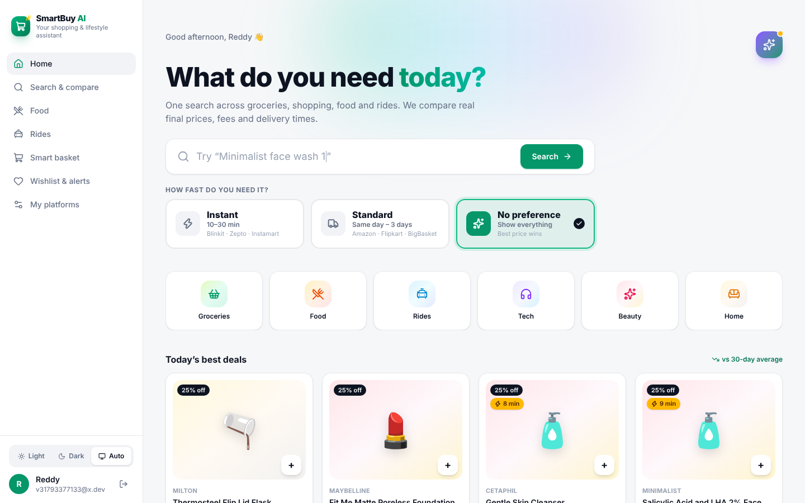
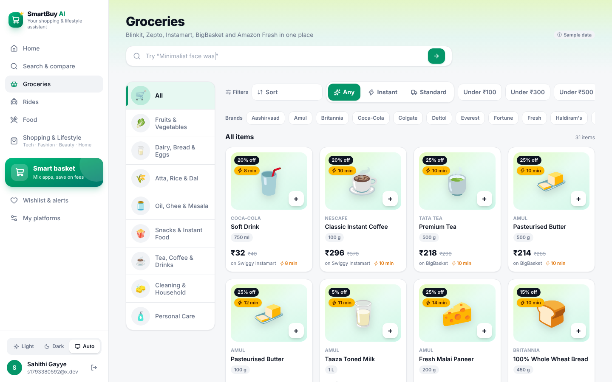
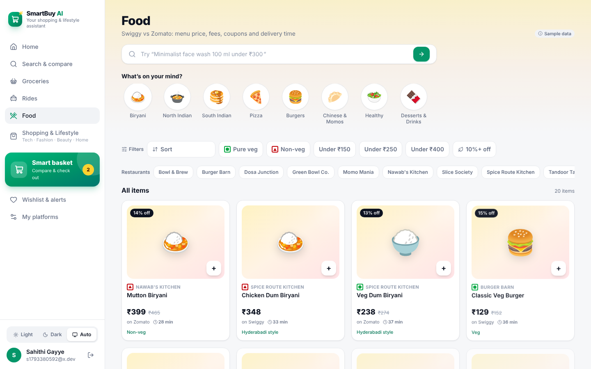
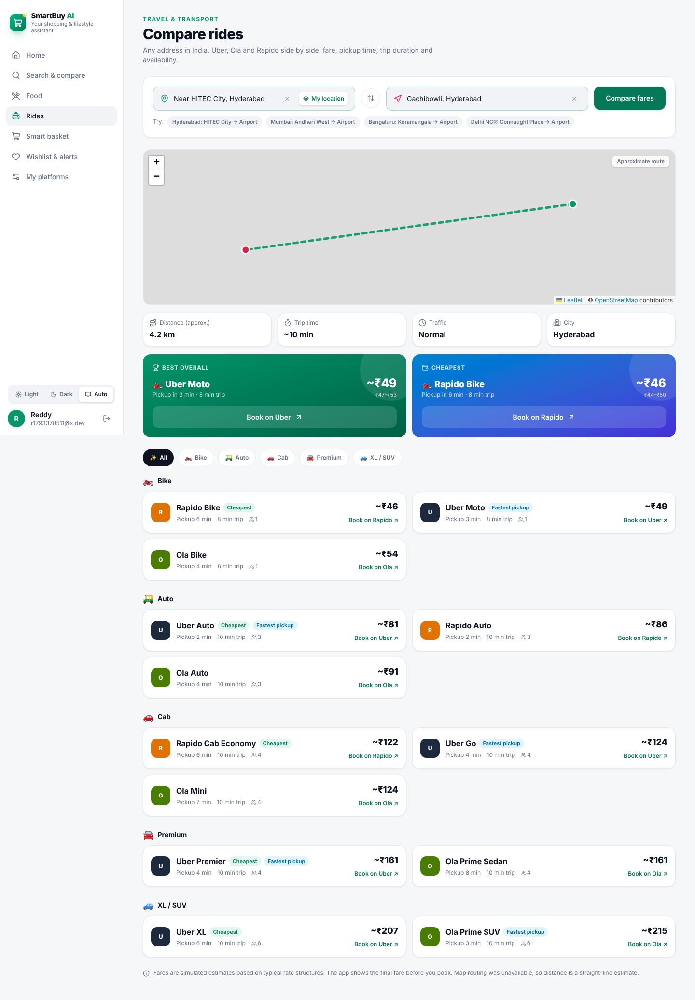
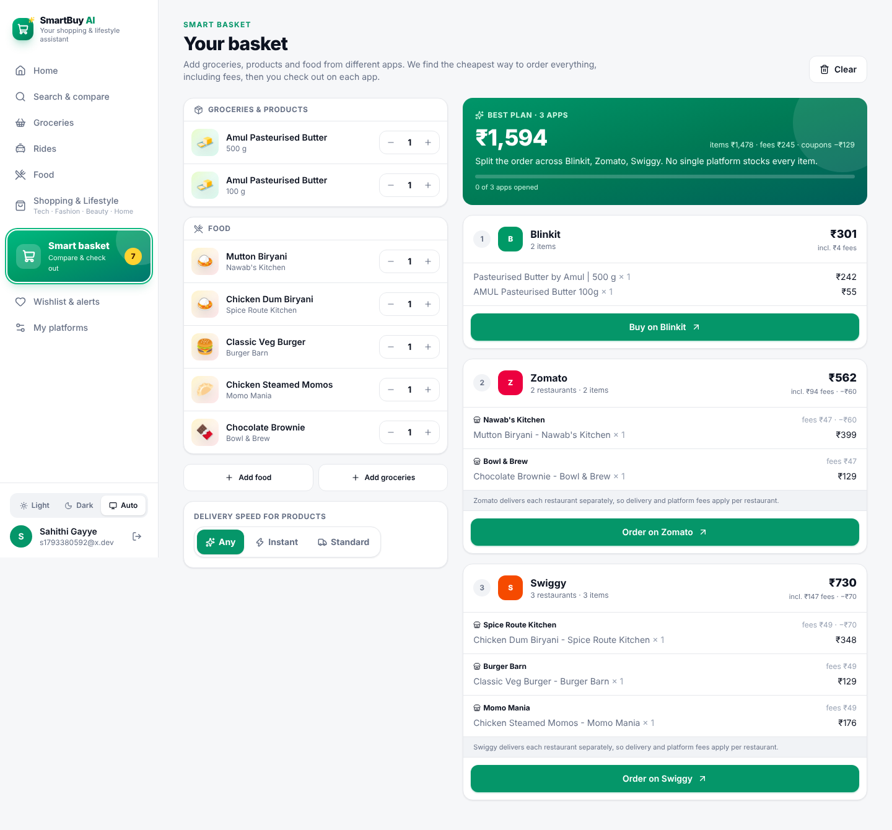
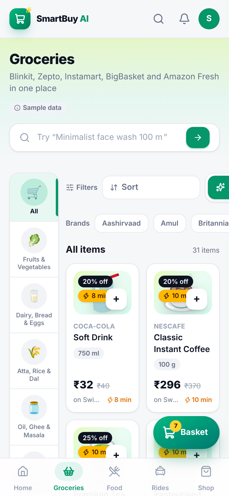

# 🛒 SmartBuy AI

**A personal shopping & lifestyle assistant.** One search across groceries, food delivery, rides and shopping & lifestyle (tech, fashion, beauty, home). SmartBuy finds the exact item, works out the *real* final price on each platform (delivery fees, platform fees, coupons), shows delivery or pickup times, and hands you off to the app you choose to finish. It never pretends to place an order.

**🔗 Live demo:** _add your Render link here_ (free hosting: the first visit after a quiet period takes ~1 minute to wake up)



> **Honest data:** Platforms connect through **integration adapters** (one per platform). Where no official API or authorised integration is configured, an adapter serves clearly labelled **sample data** (prices, fees and delivery times) or **simulated estimates** (ride fares). No scraping, and no bypassing any platform's terms or security.

---

## ✨ Features

| Area | What it does |
|---|---|
| **Section pages like the real apps** | **Groceries** with a Blinkit-style category rail (Fruits & Veg, Dairy, Atta/Rice/Dal, Snacks…), **Food** with Swiggy-style cuisine circles, veg/non-veg marks and filters, **Shopping & Lifestyle** with Tech / Fashion / Beauty / Home tabs. Every section has sort, price, discount, brand/restaurant and delivery-speed filters |
| **Search-first home** | Animated search with live suggestions, delivery-speed cards, category shortcuts, today's best deals, AI assistant icon (top right) |
| **Category-based platforms** | Choose platforms **separately per category** (Amazon for electronics, Zepto for groceries…) and star a favourite in each |
| **Delivery preference** | Instant (Blinkit, Zepto, Instamart, covering groceries, electronics and beauty) · Standard (Amazon, Flipkart, BigBasket, Croma…) · No preference |
| **Exact product matching** | Normalises messy titles; different sizes or shades are never "the same product" and show as alternatives |
| **Price comparison** | Final price = item + delivery + platform fee − coupon, ranked by price (60%), speed (20%) and reliability (20%) with plain-English reasons |
| **Food comparison** | Swiggy vs Zomato: menu price, delivery fee, platform fee, coupon, ETA, final payable |
| **Ride comparison** | **Any address in India** with live autocomplete and "use my location". Real road distance and route map (OpenStreetMap), traffic-adjusted trip time, city-aware fares, airport fees, and bikes/autos disabled for long trips. Uber, Ola, Rapido: fare range, pickup ETA, vehicle type, availability, surge |
| **Honest checkout** | "Buy on Amazon" / "Order on Swiggy" / "Book on Uber" opens the platform (Uber with pickup and drop pre-filled via its official deep link). A confirmation sheet states clearly that no order has been placed |
| **Smart basket** | Mix groceries, gadgets **and several dishes from different restaurants**. Finds the cheapest set of orders, then shows **one card and one button per app** (e.g. one "Order on Zomato" covering two restaurants, with per-restaurant fees shown honestly) plus a checklist of items to open |
| **AI assistant** | "Groceries for a family of four under ₹1,500", "Cab from Gachibowli to Charminar". Uses Claude if a key is set, otherwise a rule-based parser. Prices always come from the engine, never the AI |
| **Saved addresses** | Home / Work / Other addresses with flat no., area, landmark, pincode, receiver and phone (Indian formats validated). Pick the spot by search, GPS or by moving the map pin. The default address shows as **"Deliver to Home · Moosapet"**, appears in the basket, and becomes the ride pickup; saved addresses are one tap in Rides |
| **Wishlist & alerts** | Target prices and price-drop alerts |
| **Mobile-first UI** | Bottom navigation (Home, Groceries, Food, Rides, Shop), floating Smart Basket button with item count, account menu, light & dark themes |

| Groceries | Food |
|---|---|
|  |  |

| Rides | |
|---|---|
|  | |

| Smart basket (food + groceries) | Mobile (groceries) |
|---|---|
|  |  |

## 🧱 Tech stack

**Frontend:** React 19, TypeScript, Tailwind CSS v4, React Router, Leaflet maps, Lucide icons, Vite
**Backend:** Python, FastAPI, SQLAlchemy 2.0, PostgreSQL (psycopg 3; SQLite fallback for quick start), JWT
**Maps:** OpenStreetMap (Photon search, OSRM routing, map tiles)  
**AI:** Claude API (optional) for request understanding; custom matcher (pluggable for Sentence Transformers)
**DevOps:** Docker, docker-compose, pytest (40 tests)

## 🔌 Integration architecture

```
backend/app/integrations/adapters.py
  PlatformAdapter            base: mode (live|sample), product_link(), checkout(), info()
  ├─ AmazonAdapter           route: Product Advertising API 5.0 (needs Associates approval)
  ├─ FlipkartAdapter         route: Flipkart Affiliate API
  ├─ Blinkit/Zepto/...       no public API → sample data
  ├─ Swiggy/ZomatoAdapter    checkout verb "Order on"
  └─ UberAdapter             official universal deep link (pickup & drop pre-filled)
```

Every adapter currently reports `direct_checkout = False`, so checkout is always a **redirect handoff** (`POST /api/checkout` returns `order_placed: false`). To go live on a platform, implement its adapter with the official API and set `mode = "live"`. The UI's labels update automatically. `GET /api/integrations` exposes all of this, and the *My platforms* page shows it to users.

## 🗂️ Project structure

```
smartbuy-ai/
├── backend/app/
│   ├── main.py              # app, startup, schema version check
│   ├── models.py            # tables (per-category platform prefs, listings, history…)
│   ├── integrations/        # one adapter per platform
│   ├── services/
│   │   ├── filters.py       # per-category platforms + delivery preference
│   │   ├── matching.py      # normalisation, search, exact-match rules
│   │   ├── comparison.py    # final price + recommendation scoring
│   │   ├── rides.py         # fare estimates, deep links
│   │   ├── basket.py        # single vs split optimiser
│   │   ├── assistant.py     # natural language → structured search
│   │   └── prices.py        # price refresh + alerts
│   ├── routers/             # API endpoints
│   └── seed.py              # sample catalog (restaurant names are fictional)
├── backend/tests/           # unit + API tests
└── frontend/src/
    ├── components/          # Layout (sidebar + bottom nav), SmartSearch, UI kit
    ├── pages/               # Home, Search, Section (Groceries/Food/Shop), Compare, Rides, Assistant, Basket, Wishlist, Preferences, Profile
    ├── catalog.ts           # sections, sub-categories and sort options
    └── settings.tsx         # theme + delivery preference
```

---

## 🚀 Run it locally (Windows)

**You need:** Python 3.10+, Node.js 18+, and (optionally) PostgreSQL.

### 1. Backend

```powershell
cd smartbuy-ai\backend
python -m venv venv
venv\Scripts\activate
pip install -r requirements.txt
copy .env.example .env
notepad .env
```

Put your PostgreSQL password in `DATABASE_URL`. (Or delete that line to use SQLite.) Create the database once if needed: `psql -U postgres -c "CREATE DATABASE smartbuy;"`

```powershell
python -m uvicorn app.main:app --reload
```

API docs: **http://localhost:8000/docs**. Tables and sample data are created on first start.

> **Upgrading from an older version:** on first start, the app detects the old tables, rebuilds them and reloads sample data. Old test accounts are cleared, so just register again.

### 2. Frontend (second window)

```powershell
cd smartbuy-ai\frontend
npm install
npm run dev
```

Open **http://localhost:5173**, register, and pick your platforms.

### 3. Tests

```powershell
cd backend
python -m pytest -v
```

### Or with Docker

```powershell
docker compose up --build
```

## 🌐 Deploy (free) on Render

The repo includes a root `Dockerfile` (builds the React app and serves it from FastAPI, so it's **one service, one URL**) and a `render.yaml` Blueprint that also creates a PostgreSQL database.

1. Push this repo to GitHub.
2. On [render.com](https://render.com), sign in with GitHub and choose **New → Blueprint**, then pick the repo and click **Apply**.
3. Wait for the build (~5–10 min). The app goes live at `https://smartbuy-ai.onrender.com` (Render adds a suffix if that name is taken).

Free-tier notes: the app sleeps after 15 minutes without visits (the next visit takes about a minute to wake up), and Render's free PostgreSQL expires after 30 days. For a permanent free database, create one on Neon and set its connection string as `DATABASE_URL` in Render.

## 🤖 Optional: LLM assistant

Add `ANTHROPIC_API_KEY=...` to `backend/.env`. The LLM only turns the request into structured JSON (intent, product, budget, pickup/drop). All prices come from the comparison engine.

## 🧠 Key algorithms

- **Exact-match rules:** brand, size (units normalised: 1 L = 1000 ml), and variant (shade, shoe size) must all match. Otherwise the item is listed as an alternative with a reason.
- **Recommendation score:** `0.6 × cheapest/this + 0.2 × fastest/this + 0.2 × reliability`. A slightly dearer but much faster option can win, and the UI explains why. Your favourite platform is flagged, never forced.
- **Basket optimiser:** subset enumeration over candidate platforms (≤ 4,095 subsets), cheapest platform per item within each subset, then exact fees per order (food orders are split per restaurant).
- **Rides:** address search via **Photon** and road distance, time and route line via **OSRM** (both free OpenStreetMap services; URLs configurable in `.env`, with automatic offline fallback). Fare = (base + per km + per min, with minimum fare) × surge × city rate card (+ airport fee for cabs); drive time × traffic factor (1.25 normal, 1.6 peak, IST).

## 🛣️ Roadmap

Real integrations (Amazon PA-API, Flipkart Affiliate), Stripe test-mode demo checkout, embeddings-based matching, Celery-scheduled price refresh, self-hosted map services, Alembic migrations, image/barcode search.

---

**Resume line:** *Built a full-stack, mobile-first comparison platform (React, TypeScript, FastAPI, PostgreSQL) covering shopping, groceries, food delivery and rides, with per-category platform preferences, instant vs standard delivery filtering, exact-match product normalisation, fee-aware ranking, a basket optimiser, an LLM shopping assistant, and a pluggable adapter layer that uses official integrations and transparent checkout handoff.*
